<div align="center">

# 🏥 MedCare Hospital Management System

**An end-to-end healthcare CRM built on Salesforce**: patients, doctors, appointments, departments, billing and medical records, with automation, Apex, LWC, integrations, reports and dashboards.


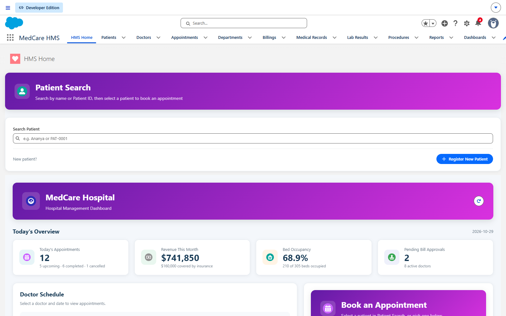

</div>

---

## Contents

- [Overview](#overview)
- [Screenshots](#screenshots)
- [Requirements checklist](#requirements-checklist-project-pdf)
- [Architecture](#architecture)
- [Data model](#data-model)
- [Security](#security)
- [Automation](#automation)
- [Apex](#apex)
- [Lightning Web Components](#lightning-web-components)
- [Reports and dashboard](#reports-and-dashboard)
- [Testing](#testing)
- [Getting started](#getting-started)
- [Manual steps](#manual-steps-not-deployable-as-metadata)
- [Project structure](#project-structure)
- [What was fixed](#what-was-fixed)

---

## Overview

MedCare Hospital is a 500-bed multi-specialty hospital moving from spreadsheets and paper forms to Salesforce. The **MedCare HMS** Lightning app covers:

| | |
|---|---|
| 🧑‍⚕️ **Patients**: registration screen flow, unique Patient ID, record types (Inpatient / Outpatient / Emergency) | 📅 **Appointments**: conflict detection, Path, confirmation / reminder / cancellation emails |
| 👩‍⚕️ **Doctors**: directory, specialization, availability, department, senior → junior hierarchy | 🏢 **Departments**: bed count, floor, Head of Department, live bed occupancy |
| 💳 **Billing**: auto-pricing from procedures, discounts and insurance, plus an emergency approval process | 📋 **Medical records & lab results**: diagnoses, prescriptions, report URLs, external lab API |
| 📊 **Admin dashboard**: today's appointments, revenue, bed occupancy, approvals, doctor workload | 🔌 **Integrations**: REST lab callout, SOAP insurance check, Apex REST API for external EHRs |

---

## Screenshots

> All screenshots are from the running app in the `MedCare` Developer org, using the demo data from [`scripts/apex/seedData.apex`](scripts/apex/seedData.apex).

### Home: patient search, dashboard, doctor schedule and booking

| Patient search (debounced Apex search) | Select a patient: the booking form is pre-filled via LMS |
|---|---|
| 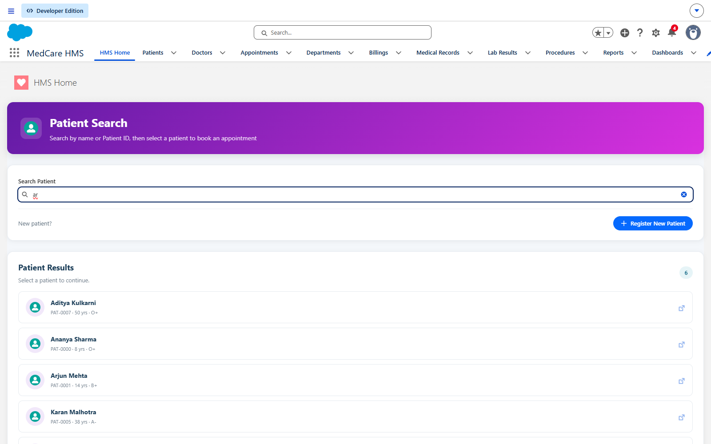 | 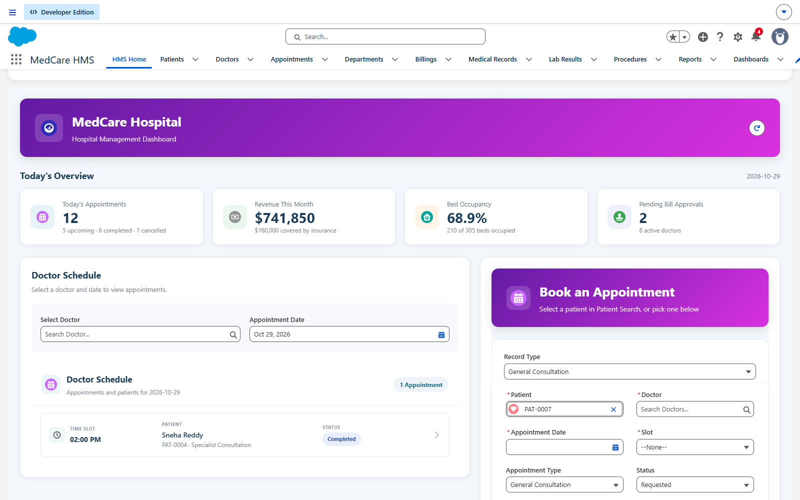 |

<p align="center">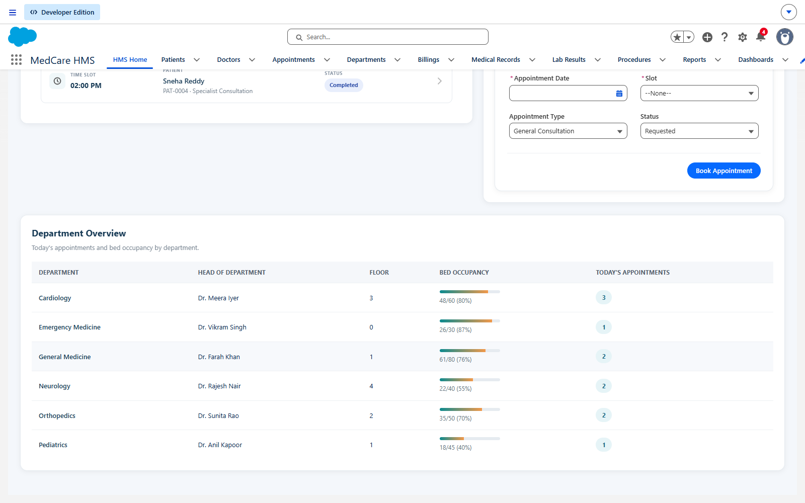<br/><em>Department-wise summary (rendering loop) with HOD, floor and bed occupancy</em></p>

### Record pages

| Patient record page with quick actions and related lists | Emergency patients get their own Lightning page (record-type assignment) |
|---|---|
| 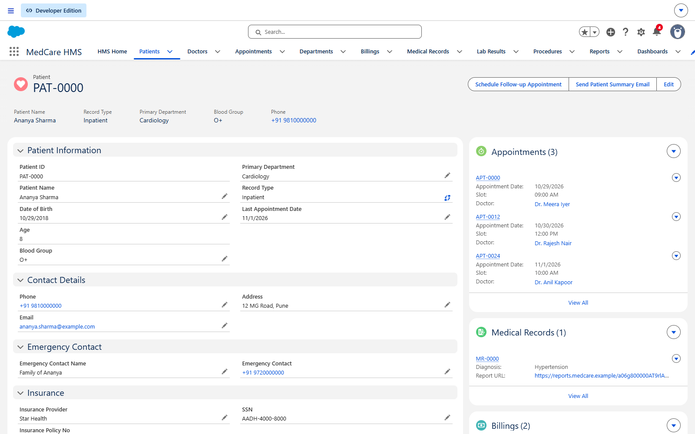 | 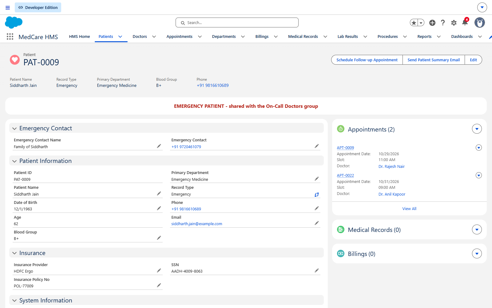 |

| Appointment with **Path** (Requested → Confirmed → Completed → Cancelled) | Doctor portal: `doctorScheduleCard` on the Doctor page |
|---|---|
| 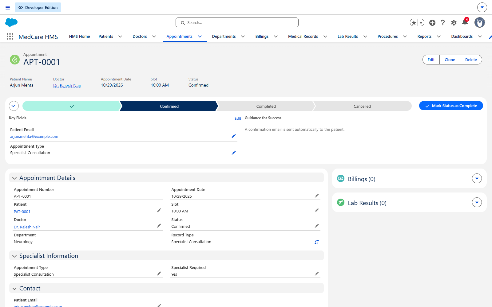 | 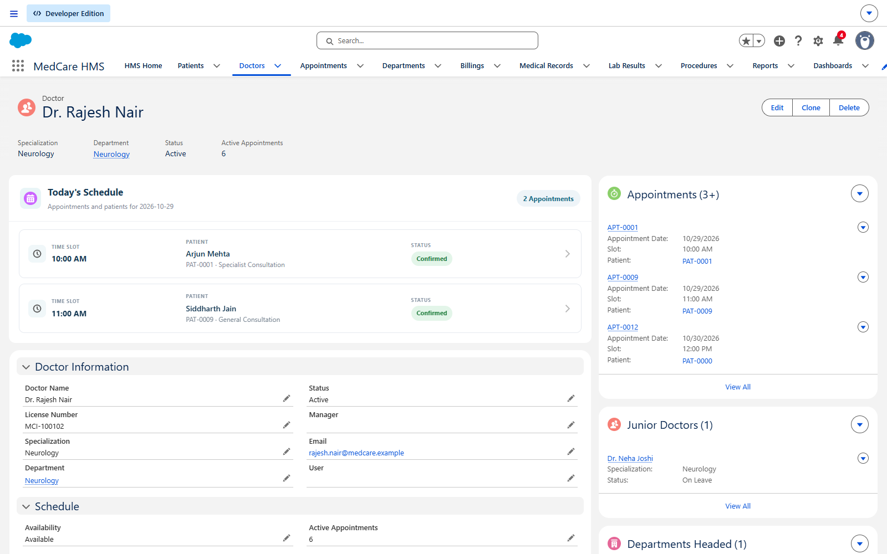 |

| Emergency billing approval (two-step approval process) | New Patient Registration screen flow |
|---|---|
| 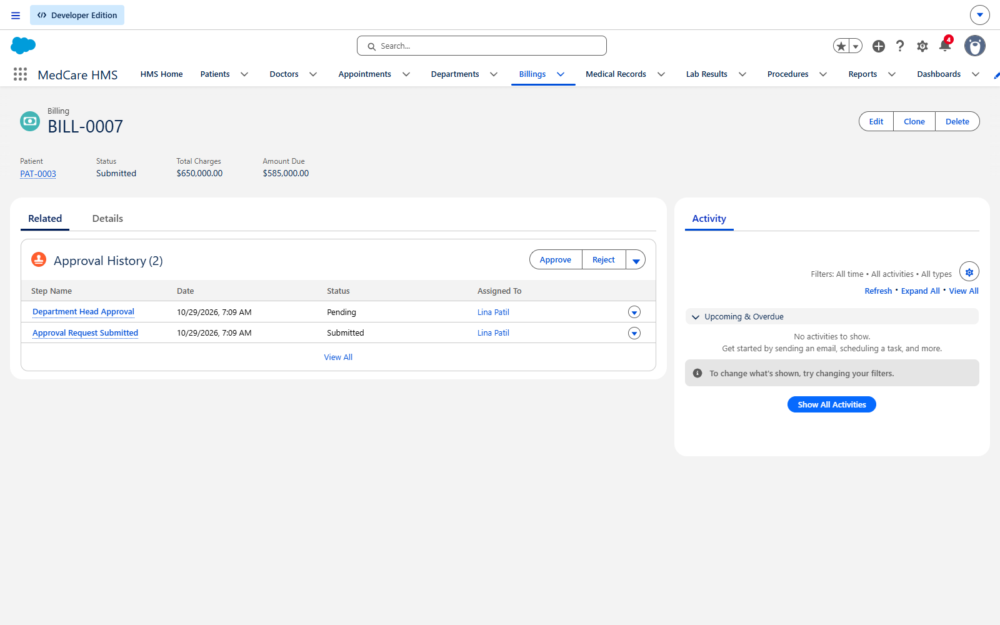 | 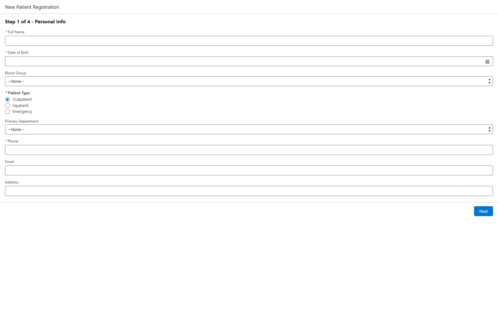 |

### Reports, dashboard and tests

<p align="center">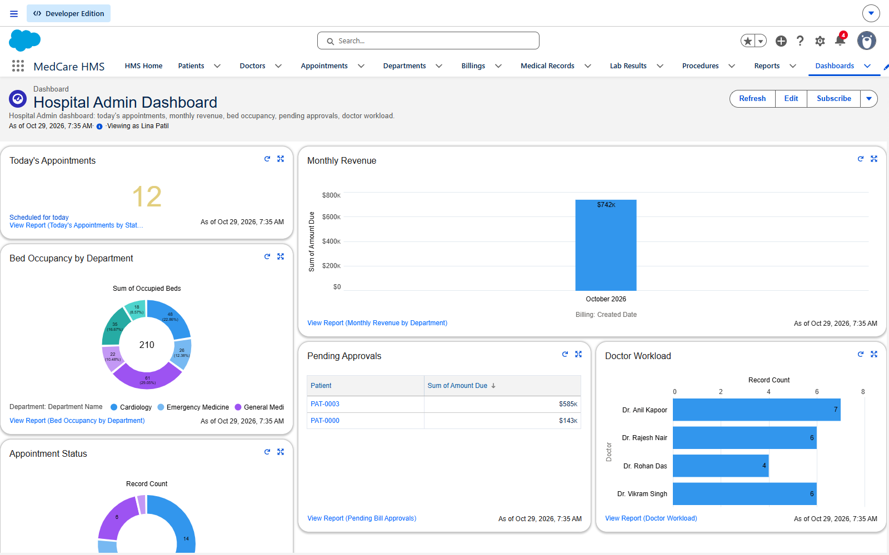<br/><em>Hospital Admin Dashboard: metric, column, donut, table, horizontal bar and pie components</em></p>

| Matrix report: Doctor Performance (doctors × month) | Summary report: Monthly Revenue by Department |
|---|---|
| 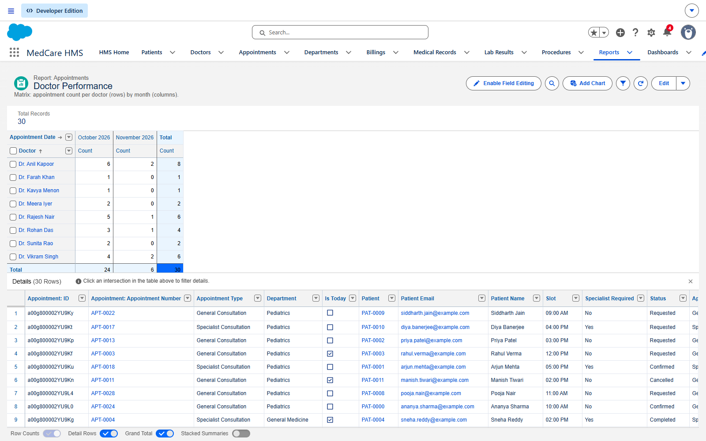 | 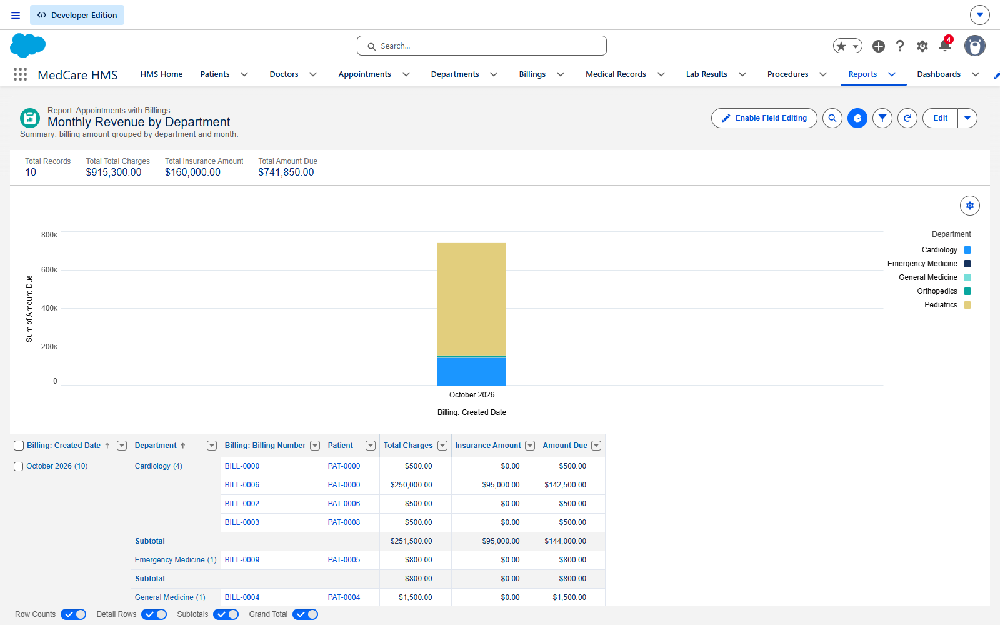 |

<p align="center">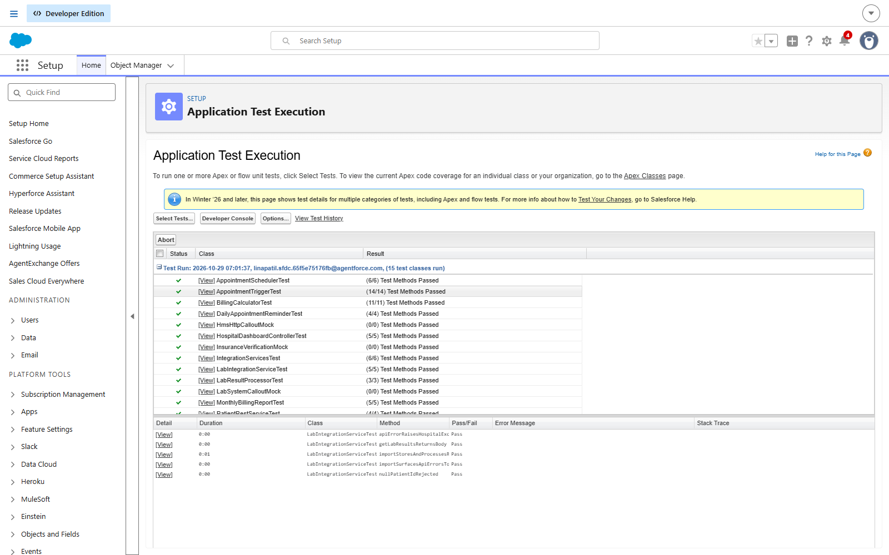<br/><em>Every Apex test class passing in the org (75 tests, 97% org-wide coverage)</em></p>

---

## Requirements checklist (project PDF)

| PDF § | Requirement | Status | Where |
|---|---|:---:|---|
| 3.1 | Custom objects Patient, Doctor, Appointment, Department, Billing, Medical Record (+ Procedure, Patient Procedure, Lab Result) | ✅ | `objects/` |
| 3.2 | Master-detail Billing → Appointment, Medical Record → Patient; lookups; M:N Patient ↔ Procedure; doctor hierarchy | ✅ | `objects/*/fields` |
| 3.3 | Formulas `Age__c`, `Is_Today__c`; roll-ups `Total_Appointments__c`, `Total_Billed_Amount__c` | ✅ | roll-ups in Apex ¹ |
| 4.1.1 | Profiles Hospital_Admin, Doctor_Profile, Receptionist_Profile; perm set Billing_Manager; PSG Doctor_Extended | ✅ | `profiles/`, `permissionsets/`, `permissionsetgroups/` |
| 4.1.2 | OWD Patient Private, Appointment Public Read Only, Billing Private ²; criteria sharing; role hierarchy; on-call group | ✅ | `sharingRules/`, `roles/`, `groups/` |
| 4.1.3 | FLS: Insurance_Amount hidden from doctors, SSN read-only for receptionists, Doctor required on receptionist layout | ✅ | profiles + `Appointment Receptionist Layout` |
| 4.2 | Doctor layout, Patient Lightning page, Path, quick actions, record-type page assignment | ✅ | `layouts/`, `flexipages/`, `pathAssistants/`, `quickActions/`, `applications/` |
| 4.3 | Record types (Patient ×3, Appointment ×3), layouts per record type, dependent picklist | ✅ | `recordTypes/`, `Specialist_Required__c` |
| 4.4 | Validation rules: slot 8 AM–8 PM (`HOUR()`), DOB not future, amount ≥ 0, `MCI-XXXXXX` regex, doctor not on leave | ✅ | `validationRules/` |
| 5.1 | Flows: Appointment Confirmation, Doctor Workload, Billing Auto-Create | ✅ | `flows/` |
| 5.2 | Scheduled flows: Daily 7 AM reminder, Monday 9 AM weekly report | ✅ | `flows/` |
| 5.3 | New Patient Registration screen flow (4 steps) + welcome email | ✅ | `flows/New_Patient_Registration_Flow` |
| 5.4 | Emergency Billing Approval (> ₹1L, second step > ₹5L, approve/reject actions) | ✅ | `approvalProcesses/`, `workflows/Billing__c` |
| 6.1 | One trigger per object + handler; conflict detection, past-date check, tasks, cancellation, counters; bulkified | ✅ | `AppointmentTrigger`, `AppointmentTriggerHandler` |
| 6.2 | PatientService, BillingCalculator, AppointmentScheduler, EmailService, HospitalException | ✅ | `classes/` |
| 6.3 | Batch, Schedulable, Future, Queueable | ✅ | `MonthlyBillingReport`, `DailyAppointmentReminder`, `SendInsuranceClaimAsync`, `LabResultProcessor` |
| 6.4 | Test classes, TestDataFactory, `SeeAllData=false`, start/stopTest, ≥ 85% coverage | ✅ **97%** | `*Test.cls` |
| 6.5 | REST callout (Named Credential + mock), SOAP insurance verification, Apex REST `/HMS/patient/{id}` | ✅ | `LabIntegrationService`, `InsuranceVerificationService`, `PatientRestService` |
| 7 | 4 LWCs, parent↔child events, LMS, NavigationMixin, app home page | ✅ | `lwc/`, `messageChannels/` |
| 8 | Tabular, summary, matrix, chart reports; dashboard with 5+ components | ✅ | `reports/`, `dashboards/` |
| 9 | SFDX project, Git, change sets / CI-CD | 🟡 | SFDX ✅, see [manual steps](#manual-steps-not-deployable-as-metadata) |

¹ Appointment → Patient is a **lookup** (as the PDF specifies), and native roll-up summaries require master-detail. The counts and sums are therefore maintained by `AppointmentTriggerHandler` and `BillingTriggerHandler`, which behave the same way as a roll-up.
² Billing is the detail side of a master-detail with Appointment, so Salesforce forces its OWD to *Controlled by Parent*. With Appointment set to Public Read Only, only users with Billing object access (the Billing_Manager permission set) can see bills.

---

## Architecture

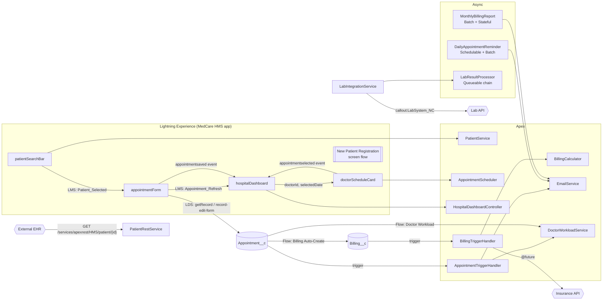

---

## Data model

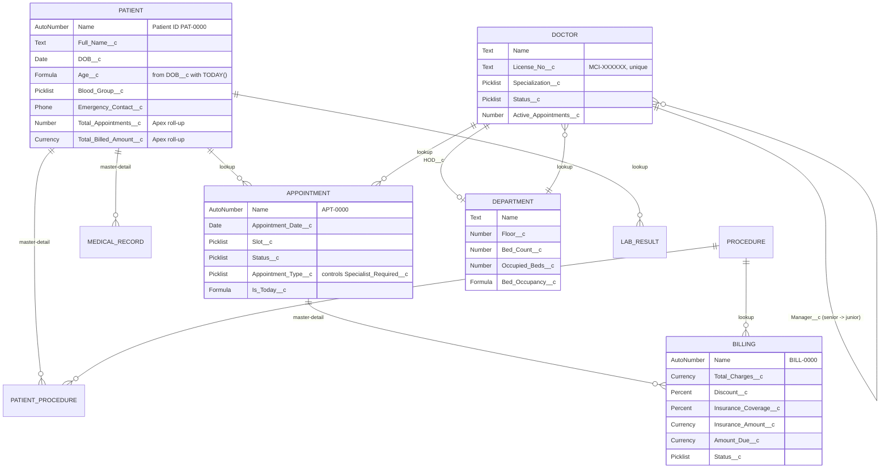

---

## Security

| | Patient | Appointment | Doctor / Dept | Billing | Medical Record | Lab Result | Apex |
|---|---|---|---|---|---|---|---|
| **Hospital_Admin** profile / `HMS_Hospital_Admin` PS | Full | Full | Full | Full | Full | Full | All |
| **Doctor_Profile** / `HMS_Doctor_Access` | Read | Read / Create / Edit | Read | **None** (Insurance_Amount FLS hidden) | Read / Create / Edit | via Lab PS | UI classes |
| **Receptionist_Profile** / `HMS_Receptionist_Access` | Create / Edit (**SSN read-only**) | Create / Edit (**Doctor required** on layout) | Read | None | None | None | **None** |
| **Billing_Manager** PS (Accounts team) | Read | Read | Read | Full | – | – | Billing classes |
| **Doctor_Extended** PSG | = Doctor Access + `HMS_Lab_Access` | | | | | | |

- **OWD:** Patient *Private*, Appointment *Public Read Only*, Billing *Controlled by Parent* (master-detail).
- **Roles:** CEO › Hospital Admin › Department Head › Doctor › Receptionist.
- **Sharing:** criteria-based rules share patients with the doctors' group for their `Primary_Department__c`; Emergency Medicine patients are shared (Read/Write) with the **On-Call Doctors** public group.

---

## Automation

| Type | Name | What it does |
|---|---|---|
| Record-triggered | **Appointment Confirmation** | Status → Confirmed: Email Alert (`Appointment_Confirmation_Template`), updates `Patient.Last_Appointment_Date__c` |
| Record-triggered | **Doctor Workload** | New appointment: recalculates `Doctor.Active_Appointments__c` (bulk-safe invocable Apex) |
| Record-triggered | **Billing Auto-Create** | Status → Completed: creates a Billing with the default charge (General ₹500 / Specialist ₹1,500 / Emergency ₹5,000) |
| Scheduled | **Daily Morning Reminder** | 7 AM daily: reminder emails for tomorrow's appointments |
| Scheduled | **Weekly Report** | Monday 9 AM: weekly appointment summary to the Hospital Admin (`HMS_Admin_Email` label) |
| Screen | **New Patient Registration** | Personal Info › Insurance › Emergency Contact › Confirmation: creates the Patient and sends a welcome email |
| Screen (quick action) | **Send Patient Summary Email** | Emails the patient a summary of their record |
| Approval | **Emergency Billing Approval** | > ₹1,00,000: Department Head (chosen by submitter); > ₹5,00,000: plus Hospital Admin. Approve → *Approved* + patient email; Reject → *Rejected* + revise task |

---

## Apex

| Class | Purpose |
|---|---|
| `AppointmentTrigger` → `AppointmentTriggerHandler` | Before insert/update: required/past-date validation, **double-booking detection** (within the batch and against the DB), patient email copy. After: confirmation task, cancellation emails, doctor workload and patient roll-ups on cancel / delete / undelete. |
| `BillingTrigger` → `BillingTriggerHandler` | Defaults the patient from the appointment, prices bills via `BillingCalculator`, rolls up `Total_Billed_Amount__c`, sends insurance claims for approved insured bills. |
| `BillingCalculator` | `gross − discount% → insurance% of net → amount due`; percentages clamped to 0–100; multi-procedure pricing. |
| `PatientService` | `searchPatients` (name / Patient ID / record Id, `WITH USER_MODE`), age group, **duplicate merge by SSN** (re-parents appointments, bills and lab results). |
| `AppointmentScheduler` | Available slots per doctor for a date range, the doctor's daily schedule, the current user's doctor record. |
| `EmailService` | Reusable templated email (`renderStoredEmailTemplate`) with plain-text fallback; never breaks the transaction if deliverability is off. |
| `HospitalDashboardController` | Today's stats, monthly revenue, bed occupancy, department summary for the dashboard LWC. |
| `DoctorWorkloadService` | `@InvocableMethod` used by the Doctor Workload flow and the trigger. |
| `HospitalException` | Domain exception. |
| **Async** | `MonthlyBillingReport` (Batch + **Stateful** + Schedulable, 1st of month), `DailyAppointmentReminder` (Schedulable + Batch, 6 AM), `SendInsuranceClaimAsync` (`@future(callout=true)`), `LabResultProcessor` (Queueable that chains itself in chunks of 100). |
| **Integration** | `LabIntegrationService` (REST GET via `LabSystem_NC`), `InsuranceVerificationService` (SOAP, WSDL2Apex-style stub via `Insurance_NC`), `PatientRestService` (`@RestResource /HMS/patient/*`, never exposes SSN). |

```bash
curl -H "Authorization: Bearer $TOKEN" https://<my-domain>.my.salesforce.com/services/apexrest/HMS/patient/PAT-0001
```

---

## Lightning Web Components

| Component | Key techniques |
|---|---|
| `patientSearchBar` | Imperative Apex, **300 ms debounce**, emits `searchresults` and `patientselected`, publishes **`Patient_Selected`** (LMS), NavigationMixin to the record and the registration flow |
| `appointmentForm` | `lightning-record-edit-form`, `getObjectInfo` for record types, **`@wire getRecord`** for the chosen doctor (blocks doctors on leave), specialist section only for *Specialist Consultation*, subscribes to `Patient_Selected`, publishes `Appointment_Refresh`, fires `appointmentsaved`, navigates to the new record |
| `doctorScheduleCard` | `@wire getAppointmentsByDoctor`, props `doctorId` / `selectedDate`, `appointmentselected` event, `@api refresh()` with `refreshApex`; works on the Doctor record page (`recordId`) or as "My Schedule" for a logged-in doctor |
| `hospitalDashboard` | Four imperative Apex calls with `Promise.all`, `for:each` department table, parent of `doctorScheduleCard` (passes date) and `appointmentForm` (child → parent event), subscribes to `Appointment_Refresh` |

---

## Reports and dashboard

Folder **HMS Reports**:

| Report | Format |
|---|---|
| Today's Appointment List (patient, doctor, status, slot) | Tabular |
| Monthly Revenue by Department | Summary + stacked column chart |
| Doctor Performance (doctors × month, appointment count) | Matrix |
| Appointment Status Distribution | Summary + pie chart |
| Today's Appointments by Status, Bed Occupancy by Department, Pending Bill Approvals, Doctor Workload | Summary (dashboard sources) |

**Hospital Admin Dashboard** (running user: HMS admin): Today's Appointments (metric), Monthly Revenue (column), Bed Occupancy by Department (donut), Pending Approvals (table), Doctor Workload (horizontal bar), Appointment Status (pie).

---

## Testing

| Suite | Result |
|---|---|
| Apex (15 test classes, 75 methods) | ✅ **75/75 passing**, **97% org-wide coverage** |
| LWC Jest (4 suites, 24 tests) | ✅ **24/24 passing**, 94% statement coverage |
| ESLint (LWC) | ✅ clean |

Every Apex test uses `@IsTest(SeeAllData=false)`, `Test.startTest()/stopTest()` and `TestDataFactory`. They cover positive, negative and **bulk (200-record)** cases, plus all pricing edge cases (zero procedures, 100%+ discount, full insurance, negative input). Callouts are mocked with `LabSystemCalloutMock`, `HmsHttpCalloutMock` and `InsuranceVerificationMock`.

```bash
npm run test:apex       # Apex tests + coverage in the default org
npm test                # LWC Jest tests
npm run lint            # ESLint
```

---

## Getting started

**Prerequisites:** [Salesforce CLI](https://developer.salesforce.com/tools/salesforcecli), Node.js 18+, a Developer Edition org.

```bash
git clone <this-repo> && cd HospitalManagmentt
npm install
```

```bash
sf org login web --alias MedCare --set-default
```

```bash
npm run deploy:validate
```

```bash
npm run deploy
```

```bash
sf org assign permset --name HMS_Hospital_Admin
```

```bash
npm run seed
```

```bash
npm run schedule-jobs
```

```bash
sf org open --path /lightning/app/c__MedCare_HMS
```

> The approval process and dashboard reference the admin username `linapatil.sfdc.65f5e75176fb@agentforce.com`. When deploying to another org (UAT / scratch), change it in
> `approvalProcesses/Billing__c.Emergency_Billing_Approval.approvalProcess-meta.xml` and `dashboards/HMS_Dashboards/Hospital_Admin_Dashboard.dashboard-meta.xml`,
> or regenerate the dashboard with `node scripts/generate/app-pages-reports.js . <username>`.

### Adding fields

Permission sets, profiles (FLS), record types and layouts are generated from the field metadata. After adding a field, regenerate and deploy:

```bash
node scripts/generate/security-and-layouts.js . <admin-username>
```

---

## Manual steps (not deployable as metadata)

| Item | How |
|---|---|
| **Users & assignments** | Create users for each persona; assign profile, role and permission sets / the `Doctor_Extended` PSG; add on-call doctors to the **On-Call Doctors** group and department doctors to the `<Dept> Doctors` groups. Link a doctor's `User__c` to their user for "My Schedule". |
| **Report subscription** | *Monthly Revenue by Department* → **Subscribe** → monthly, day 1, recipient: Hospital Admin. |
| **Named credential secrets** | `LabSystem_EC` / `Insurance_EC` are deployed with a *Custom* auth protocol. In Setup → Named Credentials → External Credentials, switch to **OAuth 2.0 Client Credentials** and enter the client id/secret from the provider's Connected App, then set the principal's parameters. |
| **Email deliverability** | Setup → Deliverability → *All email* (developer orgs default to system email only). |
| **Currency / locale** | The org's corporate currency is USD. For ₹ amounts, set Company Information → Currency Locale to *English (India) – INR*. The dashboard LWC follows the user's locale automatically. |
| **Labels** | Update `HMS_Finance_Team_Email` and `HMS_Admin_Email` (Setup → Custom Labels). |
| **Change set / UAT** | Outbound change set `HMS_Phase1_Config` with objects, fields, layouts, permission sets and profiles → upload to the UAT sandbox. Alternatively: `sf project deploy start -d force-app -o <uat-alias> --test-level RunLocalTests`. |
| **Git & CI/CD** | Branches `main`, `develop`, `feature/appointment-module`; PR feature → develop with a review checklist; Gearset/Copado pipeline develop → UAT. |

---

## Project structure

```
force-app/main/default/
├── applications/        MedCare_HMS Lightning app (record-type page assignments)
├── approvalProcesses/   Emergency Billing Approval
├── classes/             Apex services, handlers, async jobs, integrations, tests, mocks
├── dashboards/          Hospital Admin Dashboard
├── email/               HMS email templates
├── externalCredentials/ + namedCredentials/   LabSystem_NC, Insurance_NC
├── flexipages/          HMS Home, Patient / Emergency Patient / Doctor / Appointment pages
├── flows/               3 record-triggered, 2 scheduled, 2 screen flows
├── groups/ roles/ sharingRules/   Sharing model
├── labels/              Report recipient emails
├── layouts/             13 page layouts (per record type + receptionist)
├── lwc/                 4 components + Jest tests
├── messageChannels/     Patient_Selected, Appointment_Refresh
├── objects/             9 custom objects, record types, validation rules, compact layouts
├── pathAssistants/      Appointment status Path
├── permissionsets/ permissionsetgroups/ profiles/
├── quickActions/        Schedule Follow-up Appointment, Send Patient Summary Email
├── reports/             HMS Reports folder
├── tabs/ settings/ triggers/ workflows/
docs/screenshots/        README screenshots
jest-mocks/              lightning/navigation mock for Jest
scripts/apex/            seedData, scheduleJobs, runBatchesNow
scripts/generate/        Metadata generators (security, layouts, app, reports)
scripts/*.ps1            deploy-check / run-tests helpers (PowerShell)
```

---

## What was fixed

The original code compiled, but **11 of 12 Apex tests failed with 1% coverage**. Root causes and fixes:

1. **No field-level security on any HMS field.** Fields had been deployed without profile/permission-set access, and this org enforces FLS on DML, so every test insert failed with *"fields being inaccessible"*. Added the permission sets and profiles (generated from the field metadata) and fixed the System Administrator FLS.
2. **Tests used slot values that don't exist** (`'09:00 AM - 09:30 AM'`) on a restricted picklist (`'09:00 AM'`), and reused a hard-coded unique license number.
3. **Local source was out of sync with the org.** `Appointment__c`, `Billing__c`, `Procedure__c` and many fields existed only in the org; they were retrieved into source.
4. **Logic bugs:** completed appointments in the past could never be updated; rescheduling skipped conflict checks; the doctor counter was double-incremented (trigger and flow) and drifted; `MonthlyBillingReport` lost totals between batches (no `Database.Stateful`); `BillingCalculator` was never called; roll-ups were never populated; `Patient_Selected` message channel had a double `.xml.xml` extension; the "Specialist" LWC check never matched the real record type label; the dashboard used the UTC date; navigation used a non-existent `standard__flow` page reference.
5. **Jest tests were placeholders** (`expect(1).toBe(1)`). They were replaced with 24 real tests.
